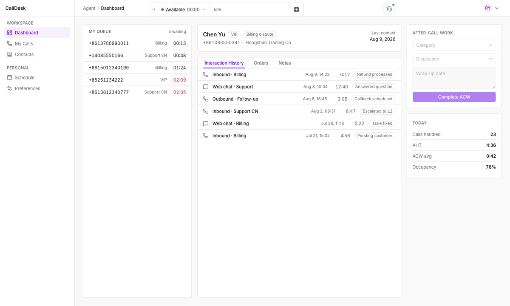

# AI Native Call Center

An open-source call center where the AI is the default answer, not an add-on.

Calls arrive at FreeSWITCH and are answered by a voice model over a
speech-to-speech connection the application terminates itself. The model talks;
a flow steers the conversation and decides when a person is needed. When one
is, the caller is transferred into a real queue where real agents are waiting,
their SIP leg held by a companion Chrome extension. Everything the two halves
do lands in one call record.

It is **one Go binary** — REST API, event stream and the whole web interface
inside it — plus PostgreSQL and FreeSWITCH.

[简体中文](README.zh-CN.md) · [Deploying](deploy/README.md) ·
[Design](docs/design/00-overview.md)

<!-- Recorded from the agent desktop prototype (ui-test / CallDesk): an inbound
     call answered, the live transcript filling in, then after-call work. -->


## Try it

Linux:

```sh
curl -fsSL https://github.com/rasonyang/ai-native-callcenter/releases/latest/download/install.sh | sudo sh
```

macOS:

```sh
curl -fsSL https://github.com/rasonyang/ai-native-callcenter/releases/latest/download/install.sh | sh
```

Details: [deploy/one-line-installer.md](deploy/one-line-installer.md).

## API

The API is the product and [`docs/openapi.json`](docs/openapi.json) is its
contract: the web interface is one consumer of it, with no more privilege
than your integration, and a scoped API key reaches everything a session
cookie reaches.

The [API reference](https://rasonyang.dev/aicc/api/) renders the contract; a
deployment serves its own at `GET /api/v1/openapi.json`. The event stream is
covered by the [events guide](docs/events.md), and a finished call reaches a
subscribed endpoint as the `cdrDelivery` webhook declared in the contract.

Against `make stack-up` (API on `http://localhost:8080`, seeded
`admin`/`aicc@123`):

```sh
# 1. Sign in, then issue a scoped key — the secret answers only this once
curl -c jar -H 'Content-Type: application/json' -d '{"username":"admin","password":"aicc@123"}' localhost:8080/api/v1/auth/login
curl -b jar -H 'Content-Type: application/json' -H 'X-AICC-Csrf: 1' -d '{"name":"demo","scopes":["calls:create","calls:create:ai","calls:read:all","history:read:all","config:write"]}' localhost:8080/api/v1/api-keys
# → {"id":"019a1f00-…","keyPrefix":"…","secret":"…"} — set KEY=<secret>

# 2. Place a call on the main line's flow (a phone registered as
#    2125550101 is the callee — deploy/README.md)
curl -H "Authorization: Bearer $KEY" -H 'Content-Type: application/json' -d '{"kind":"AI_OUTBOUND","did":"8005550199","to":"2125550101"}' localhost:8080/api/v1/calls
# → {"callId":"019a3c2e-…"} — set CALL=<callId>

# 3. Follow the ordered event stream
curl -N -H "Authorization: Bearer $KEY" localhost:8080/api/v1/events
# → id:/event:/data: frames — PARTY_DIALING … PARTY_RELEASED … CALL_CDR

# 4. Read the record the call left
curl -H "Authorization: Bearer $KEY" localhost:8080/api/v1/cdrs/$CALL
# → {"cdr":{…},"transcript":[…],"recordings":[…]}

# 5. Subscribe an endpoint; every finished call is POSTed its CDR
curl -H "Authorization: Bearer $KEY" -H 'Content-Type: application/json' -d '{"name":"cdr-feed","url":"https://example.com/cdr","isEnabled":true}' localhost:8080/api/v1/webhook-subscriptions
# → {"subscriptionId":"019a1f00-…","hasAuthToken":false}
```

## What it does

**Answers with a model, not a menu.** The AI leg is a SIP endpoint inside the
application: FreeSWITCH bridges the caller to it and audio goes straight to the
provider — G.711 passed through byte for byte where the provider accepts it, so
nothing decodes or resamples on the way.

**Steers without scripting the conversation.** The model owns the dialogue; the
flow owns the phase. A phase carries instructions and a list of tools the model
may use; transitions fire on tool results. A phase may also carry a line of its
own — a greeting, a hand-over script, a goodbye — which the bot is meant to say
as written rather than paraphrase: `doubao` is handed the words to speak, the
other four providers are instructed to repeat them word for word. The built-in
tools may *refuse* —
"the queue is closed" is something to talk about, not an error — and the
persona, the rules and the bot's voice are published and versioned together.

**Hands over to people properly.** Transfers go into `mod_callcenter` queues,
and the agent's screen has popped by the time the phone rings: a
`PARTY_RINGING` event over SSE says who is calling and carries the call's
`userData`, and the bot-phase transcript is already there to read, because the
call id is minted before any leg exists and survives the transfer. Agents work
in the browser: presence, call control, callbacks — but not the audio, which
belongs to the [web-sip-phone](https://github.com/rasonyang/web-sip-phone)
Chrome extension, a separate repository. It holds the agent's SIP registration
with credentials this application issues at sign-in, and it has no dialpad of
its own: answering, holding and hanging up are REST calls here, carried to the
phone over ESL `uuid_phone_event`. Supervisors get a live wallboard, the queue
view and the roster.

**Keeps one record per conversation.** A call that a bot answered, handed to a
queue and an agent finished is one CDR with one transcript and one recording —
not three fragments. Recordings go to a filesystem or to any S3-compatible
store.

**Speaks two languages, and admits which provider it runs.** English and
Chinese throughout, interface and bot. One provider answers every call in a
deployment, chosen at startup: `qwen` or `doubao` inside mainland China,
`openai` or `grok` elsewhere, or `gateway` for a Realtime gateway of your
own (such as
[cascade-realtime-gateway](https://github.com/rasonyang/cascade-realtime-gateway)).
A call's language never selects it. Four of those are profiles of one
protocol; `doubao` speaks a different one and has a client of
its own ([how a provider is added](docs/provider-extension.md)).

## How it fits together

```
                    ┌──────────── one Go binary ────────────┐
  caller ──▶ FreeSWITCH ──▶ SIP UAS ──▶ provider (Realtime, speech-to-speech)
                 │            │
                 │            └─ flow engine: phases, tools, transfers
                 │
                 ├─ mod_callcenter queues ──▶ agents (browser + web-sip-phone)
                 │
                 └─ ESL ──▶ call registry ──▶ REST + SSE ──▶ web interface
                                                    │
                                              PostgreSQL
```

FreeSWITCH reads its directory and its `mod_callcenter` queues *from the
database*, through Lua. The dialplan is static XML, but its rules decide
nothing by themselves: each one hands the call to a Lua script that looks the
answer up. Adding an extension, a queue or a number is a database change; the
switch's own files change only when the routing itself does.

Two design notes worth knowing before reading the code:

* The domain model is Genesys-lineage. A **call** aggregates **parties**; leg
  events are `PARTY_*`, call-scoped ones are `CALL_*`.
* Every live call is an actor — one goroutine as its sole mutator, snapshots by
  mailbox. Nothing in `internal/telephony` locks call state, because there is
  no shared call state; the AI leg is the exception, holding mutexes over the
  playback and recording state its own goroutines share.

The full design is in [`docs/design/`](docs/design/), starting with
[the overview](docs/design/00-overview.md).

## Building

```sh
make dev-up            # PostgreSQL in Docker
cd web && npm install && npm run build && cd ..
make build             # bin/aicc, with the interface embedded
./bin/aicc useradd -username admin -password '…' -role ADMIN
./bin/aicc
```

For frontend work, `make web-dev` runs Vite on 5173 against the API on 8080.

```sh
go test -race ./...    # always -race; it has caught real bugs here
make lint              # go vet, gofmt, oxlint
make api-check         # the API contract gate
```

The HTTP API is spec-first: [`docs/openapi.json`](docs/openapi.json) is the
single source of truth, and the Go server and the TypeScript client are
generated from it. Edit the contract, run `make api-generate`, then implement.
Never the other way round.

## Extending it

* **A new voice provider** is a profile, not a client:
  [`docs/provider-extension.md`](docs/provider-extension.md).
* **A new flow** is a JSON document validated at load — see
  [`docs/flow-authoring.md`](docs/flow-authoring.md) for how to write one and
  [`internal/seed/flows/`](internal/seed/flows/) for working bilingual ones.
* **A new screen** follows the design system in
  [`web/CLAUDE.md`](web/CLAUDE.md), which is binding rather than advisory.
* **An integration with another product** is a service behind the flow's
  backend URL, never code in this tree:
  [`CONTRIBUTING.md`](CONTRIBUTING.md#integrations-live-outside-the-tree).

## Status

The human path, the AI path, the product surface and the packaging are built
and verified against live FreeSWITCH and live providers.

What is deliberately *not* here, and will not be: any cascaded
ASR + LLM + TTS pipeline inside this process. That composition belongs in a
separate service speaking the same protocol, such as
[cascade-realtime-gateway](https://github.com/rasonyang/cascade-realtime-gateway).

## License

Apache-2.0. See [LICENSE](LICENSE).
